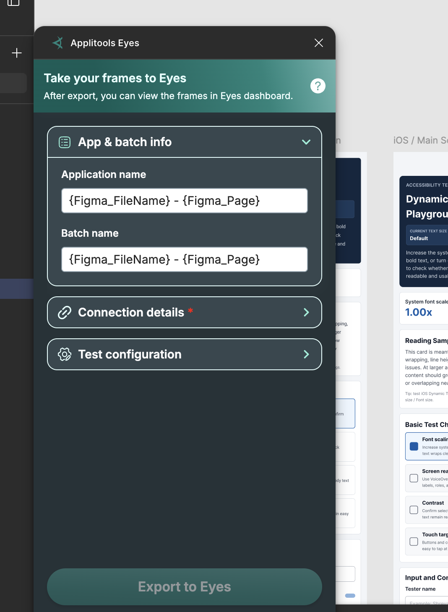
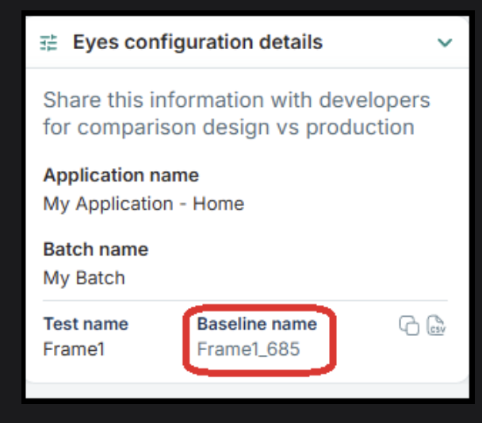
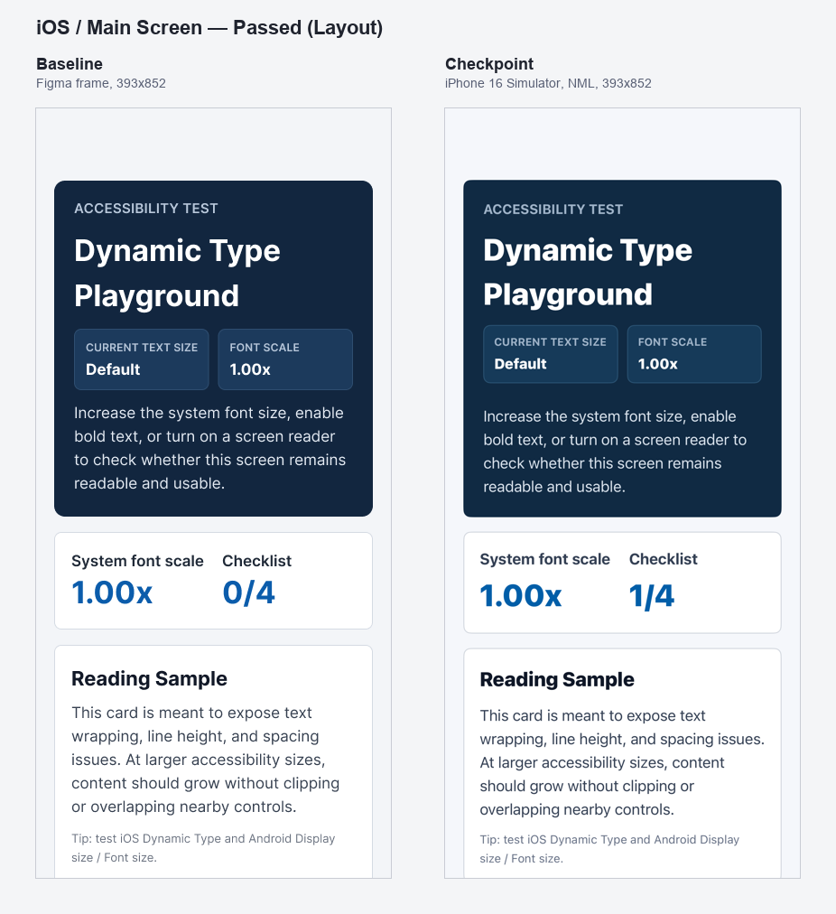
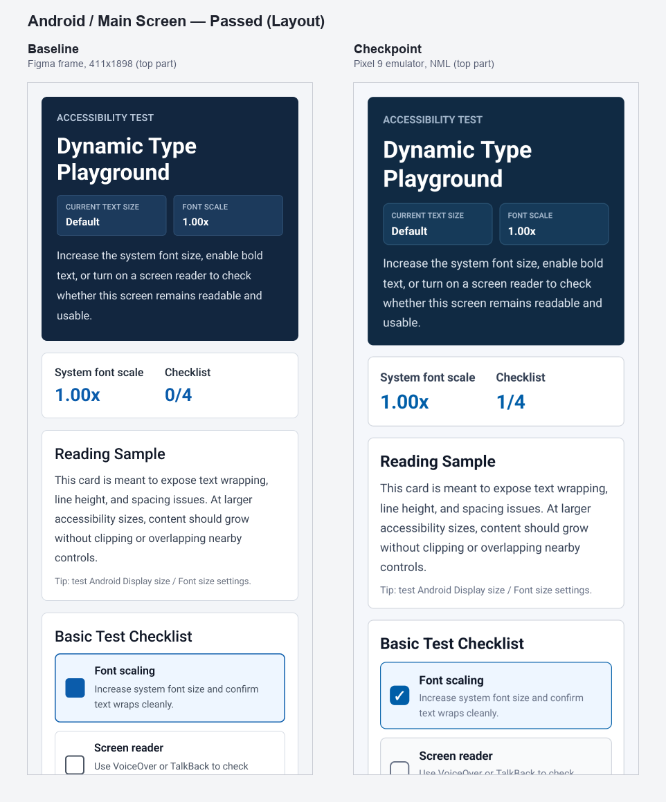

# Figma vs mobile app — execution steps

Requirement: the Figma frames are already exported to the Eyes Dashboard with the [Applitools Eyes Figma plugin](https://www.applitools.com/docs/eyes/integrations/design-validation/figma-plugin), and you have the **Baseline name** of each frame. After the export, the plugin shows it under **Eyes configuration details**. Copy it into `baseline_env_name` in `figma_config.py`.

Export from Figma: **Plugins → Applitools Eyes → Export to Eyes**.



After the export, open **Eyes configuration details** and copy the **Baseline name** (for example `Frame1_685`).



Requirement: Appium is running (`appium`), the iOS Simulator or Android emulator is started, and the Figma values are in `figma_config.py`. The README in [`ios/`](ios) or [`android/`](android) shows how.

## Sample values

| Value | Where it comes from | Sample value |
|---|---|---|
| `APPLITOOLS_API_KEY` | Eyes Dashboard → your profile → My API key | `aBcD1234...` |
| `APP_NAME` | Figma plugin → App name | `NML Python – Figma vs Mobile (demo) - Page 1` |
| `frame` | Figma frame name (= test name in Eyes) | `iOS / Main Screen`, `Android / Main Screen` |
| `baseline_env_name` | Figma plugin → Eyes configuration details → Baseline name | `Frame1_685` (`Figma \| iOS / Main Screen` in the sample below) |
| `fully` | `False`: visible screen only, `True`: full scrollable screen | `False` |
| `IOS_UDID` | `xcrun simctl list devices available` | `258C9CC4-4C21-44CB-903B-AEA4C056B484` |
| `DEVICE_NAME` (iOS, instead of `IOS_UDID`) | Simulator name | `iPhone 16` |
| `AVD_NAME` | `emulator -list-avds` | `Pixel_9` |
| `PLATFORM_VERSION` | Simulator / emulator OS version | `18.0` (iOS), `16` (Android) |
| `CAPTURE` | How the screen is captured | `nml` or `sdk` |

Your values come from your own Figma export; the Baseline name is whatever the plugin shows for each frame.

Sample `ios/figma_config.py`:

```python
APP_NAME = "NML Python – Figma vs Mobile (demo) - Page 1"

FRAMES = {
    "nml": [
        {"frame": "iOS / Main Screen", "baseline_env_name": "Figma | iOS / Main Screen",
         "node_id": "1:28", "fully": False},
        {"frame": "iOS / Main Screen | Full", "baseline_env_name": "Figma | iOS / Main Screen | Full",
         "node_id": "3:2", "fully": True},
    ],
    "sdk": [
        {"frame": "SDK / iOS / Viewport", "baseline_env_name": "Figma | SDK / iOS / Viewport",
         "node_id": "4:2", "fully": False},
        {"frame": "SDK / iOS / Full Page", "baseline_env_name": "Figma | SDK / iOS / Full Page",
         "node_id": "4:72", "fully": True},
    ],
}
```

Sample `android/figma_config.py`:

```python
APP_NAME = "NML Python – Figma vs Mobile (demo) - Page 1"

FRAMES = {
    "nml": [
        {"frame": "Android / Main Screen", "baseline_env_name": "Figma | Android / Main Screen",
         "node_id": "2:2", "fully": True},
    ],
    "sdk": [
        {"frame": "SDK / Android / Viewport", "baseline_env_name": "Figma | SDK / Android / Viewport",
         "node_id": "4:142", "fully": False},
    ],
}
```

## Step 1: Install

```
cd ios                     # or: cd android
python3 -m venv .venv
source .venv/bin/activate
pip install -r requirements.txt
export APPLITOOLS_API_KEY=<your Applitools API key>
```

## Step 2: Run the test

Choose how the app screen is captured with `CAPTURE`:

- `CAPTURE=nml`: the Applitools Native Mobile Library (NML) inside the app captures the screen. This is the default.
- `CAPTURE=sdk`: the Eyes Appium SDK captures the screen with an Appium screenshot. The status bar is cropped, so these use their own Figma frames (`"sdk"` in `figma_config.py`).

**iOS — NML** (in `ios/`)

```
CAPTURE=nml IOS_UDID=<simulator udid> PLATFORM_VERSION=<iOS version> pytest test_figma_ios.py
```

**iOS — SDK** (in `ios/`)

```
CAPTURE=sdk IOS_UDID=<simulator udid> PLATFORM_VERSION=<iOS version> pytest test_figma_ios.py
```

**Android — NML** (in `android/`)

```
CAPTURE=nml AVD_NAME=<avd name> PLATFORM_VERSION=<Android version> pytest test_figma_android.py
```

**Android — SDK** (in `android/`)

```
CAPTURE=sdk AVD_NAME=<avd name> PLATFORM_VERSION=<Android version> pytest test_figma_android.py
```

Example:

```
CAPTURE=nml AVD_NAME=Pixel_9 PLATFORM_VERSION=16 pytest test_figma_android.py
```

To run your own app instead of the sample in `app/`, add `APP_PATH=/path/to/your/app` in front of the command.

## Step 3: See the result

The test prints one Eyes link per Figma frame. Open it in the Eyes Dashboard:

- **Passed**: the app screen matches the Figma frame.
- **Unresolved**: Eyes found differences; they are highlighted on the screen. Accept (thumbs up) or reject (thumbs down) each one.





The baseline is the Figma frame; the checkpoint is the app screen. Here Checklist shows `0/4` in Figma and `1/4` in the app, and the test still passes: Layout checks position and structure, not text. Use `MATCH_LEVEL=STRICT` to catch text and colour differences too.
