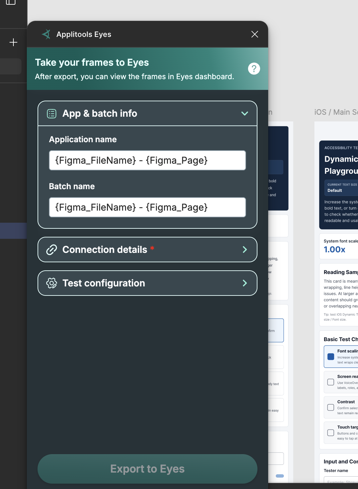
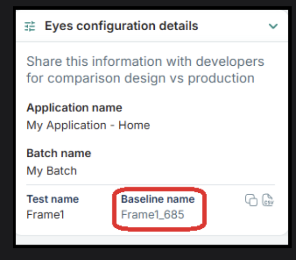
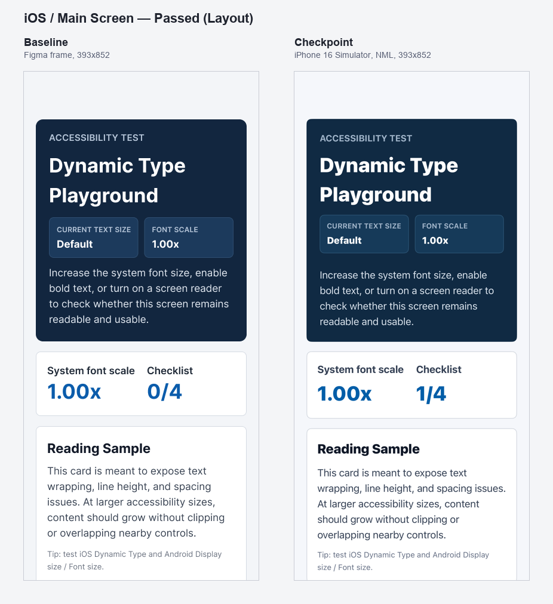

# Figma vs iOS app — execution steps

Requirement: the Figma frames are already exported to the Eyes Dashboard with the [Applitools Eyes Figma plugin](https://www.applitools.com/docs/eyes/integrations/design-validation/figma-plugin), and you have the **Baseline name** of each frame. After the export, the plugin shows it under **Eyes configuration details**. Copy it into `baseline_env_name` in `figma_config.py`.

Export from Figma: **Plugins → Applitools Eyes → Export to Eyes**.



After the export, open **Eyes configuration details** and copy the **Baseline name** (for example `Frame1_685`).



Requirement: Python 3.9+, Node.js, and an iOS Simulator (Xcode).

## Sample values

| Value | Where it comes from | Sample value |
|---|---|---|
| `APPLITOOLS_API_KEY` | Eyes Dashboard → your profile → My API key | `aBcD1234...` |
| `APP_NAME` | Figma plugin → App name | `NML Python – Figma vs Mobile (demo) - Page 1` |
| `frame` | Figma frame name (= test name in Eyes) | `iOS / Main Screen` |
| `baseline_env_name` | Figma plugin → Eyes configuration details → Baseline name | `Frame1_685` (`Figma \| iOS / Main Screen` in the sample below) |
| `fully` | `False`: visible screen only, `True`: full scrollable screen | `False` |
| `IOS_UDID` | `xcrun simctl list devices available` | `258C9CC4-4C21-44CB-903B-AEA4C056B484` |
| `DEVICE_NAME` (iOS, instead of `IOS_UDID`) | Simulator name | `iPhone 16` |
| `PLATFORM_VERSION` | Simulator / emulator OS version | `18.0` |
| `CAPTURE` | How the screen is captured | `nml` or `sdk` |

Your values come from your own Figma export; the Baseline name is whatever the plugin shows for each frame.

Sample `figma_config.py`:

```python
APP_NAME = "NML Python – Figma vs Mobile (demo) - Page 1"

FRAMES = {
    "nml": [
        {"frame": "iOS / Main Screen", "baseline_env_name": "Figma | iOS / Main Screen",
         "node_id": "1:28", "fully": False},
        {"frame": "iOS / Main Screen | Full", "baseline_env_name": "Figma | iOS / Main Screen | Full",
         "node_id": "3:2", "fully": True},
    ],
    "sdk": [
        {"frame": "SDK / iOS / Viewport", "baseline_env_name": "Figma | SDK / iOS / Viewport",
         "node_id": "4:2", "fully": False},
        {"frame": "SDK / iOS / Full Page", "baseline_env_name": "Figma | SDK / iOS / Full Page",
         "node_id": "4:72", "fully": True},
    ],
}
```

## Step 1: Install

```
cd ios
python3 -m venv .venv
source .venv/bin/activate
pip install -r requirements.txt
npm i -g appium
appium driver install xcuitest
```

## Step 2: Set your Applitools API key

```
export APPLITOOLS_API_KEY=<your Applitools API key>
```

## Step 3: Add the Figma values to `figma_config.py`

Copy these from the Figma export (plugin → **Eyes configuration details**):

- `APP_NAME` = the App name.
- For each frame in `FRAMES["nml"]` (NML capture) and `FRAMES["sdk"]` (SDK capture):
  - `frame` = the frame name (the test name in Eyes).
  - `baseline_env_name` = the Baseline name.

The values must match exactly. If one is different, Eyes saves the app screen as a new baseline instead of comparing it with the Figma frame.

## Step 4: Start Appium

In a separate terminal:

```
appium
```

## Step 5: Start the iOS device

```
xcrun simctl list devices available | grep iPhone     # copy the UDID of a Simulator
xcrun simctl boot <simulator udid>
open -a Simulator
```

## Step 6: Run the test

```
CAPTURE=nml IOS_UDID=<simulator udid> PLATFORM_VERSION=<iOS version> pytest test_figma_ios.py
CAPTURE=sdk IOS_UDID=<simulator udid> PLATFORM_VERSION=<iOS version> pytest test_figma_ios.py
```

- `CAPTURE=nml` (default): the Applitools Native Mobile Library inside the app captures the screen.
- `CAPTURE=sdk`: the Eyes Appium SDK captures an Appium screenshot (status bar cropped).

Example:

```
CAPTURE=nml DEVICE_NAME="iPhone 16" PLATFORM_VERSION=18.0 pytest test_figma_ios.py
```

The test opens the sample app in `app/`, captures the screen for each frame in `figma_config.py`, and compares it with the Figma frame. To run your own app, add `APP_PATH=/path/to/your/app` in front of the command.

## Step 7: See the result

The test prints one Eyes link per frame. Open it in the Eyes Dashboard:

- **Passed**: the app screen matches the Figma frame.
- **Unresolved**: Eyes found differences; they are highlighted on the screen. Accept (thumbs up) or reject (thumbs down) each one.



The baseline is the Figma frame; the checkpoint is the app screen. Here Checklist shows `0/4` in Figma and `1/4` in the app, and the test still passes: Layout checks position and structure, not text. Use `MATCH_LEVEL=STRICT` to catch text and colour differences too.
